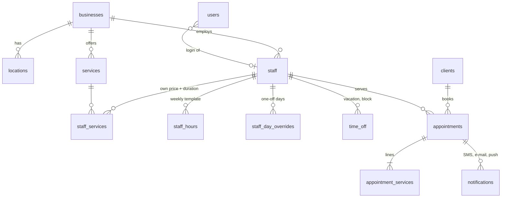

# Data model: draft 1

*17.11.2026. A draft for Dim to read, not built yet. It follows kickoff §6
(generic from the start) and copies patterns that already work in the shop
(`rempire-web/db/migrations`). Points that wait on an answer are marked
**[open]** with the question they wait on.*

## Rules for every table

- **Generic.** Business → Location → Staff. Every row carries `business_id`,
  so tattoo or another salon needs no reshaping later (Renat Q14, Q15).
- **Money** in integer cents (`*_cents int`), EUR. **VAT rates** in basis
  points (`2400` = 24 %), stored on every line, never looked up later.
- **Durations** in whole minutes.
- **Time.**
  - A moment is `timestamptz`.
  - A schedule is local wall-clock (`date` + `time`) read in the location's
    `timezone` (`Europe/Tallinn`).
  - Slot maths runs in local time and converts each slot with a tz library,
    never a fixed +02/+03, so both DST change days come out right.
- **IDs:** `uuid default gen_random_uuid()` (core on PG 13+, built into
  PGlite, as the shop's `001_core.sql` notes).
- **Texts clients see** (service names, role labels) are `jsonb`
  `{ru, et, en}`.
- **No hard deletes** of appointments or invoices. Status columns instead.
- **Every create is idempotent.** Copy the shop's `180_idempotency.sql`: the
  client mints a key per intention, so a double tap on «Book» books once.
- **Migrations:** numbered plain SQL, recorded by name, tests on PGlite, as
  in the shop. **[open]** Dim's answer on `db-layer`.
- **Seeds and tests use fake people only.**

## Map (Phase A)



## Phase A: booking core

### Who and where

| Table | Key columns | Notes |
|---|---|---|
| `businesses` | `slug`, `name`, `timezone`, `default_locale`, `settings jsonb` | `settings` holds the cancellation window, slot grid (15 min, as Altegio), the default reminder (120 min). |
| `locations` | `business_id`, `name`, `address`, `timezone`, `phone` | One today (Mardi 1). Altegio shows a location switcher, so keep it. |
| `staff` | `business_id`, `location_id`, `slug`, `display_name`, `role jsonb`, `photo_url`, `bio jsonb`, `bookable`, `sort`, `active` | `role` is the label: «Барбер» / «Tattoo artist». `slug` gives each rempire.ee card its own link with the barber pre-selected (kickoff §3, the free win). |
| `users` | `email` unique, `password_hash`, `google_sub` unique, `role` (`owner`/`admin`/`staff`), `staff_id`, `locale`, `active` | Logins for Renat and barbers. Clients are not users. Dim's choice: a password, or Google, with an e-mail code as the backup. `password_hash` is scrypt (built into Node, no native module). `google_sub` is Google's stable user id, never the e-mail. |
| `login_codes` | `email`, `code_hash`, `expires_at`, `attempts`, `used_at` | The 6-digit backup code by e-mail: a forgotten password, or Google not working. 10 minutes, 5 tries. |
| `sessions` | `token_hash`, `user_id`, `expires_at`, `device` | Long-lived for the barber PWA. |

**Google login, to test early:** an iPhone home-screen PWA opens Google's
sign-in page outside the app. Check on a real iPhone that the session
lands back in the installed app. If it doesn't, the barber app offers
password and code first there. Google needs an OAuth client in a Google
Cloud project. **[open]** Which Google account owns it, the shop's or
Dim's. Env var names: `GOOGLE_CLIENT_ID`, `GOOGLE_CLIENT_SECRET`.

### What and when

| Table | Key columns | Notes |
|---|---|---|
| `services` | `name jsonb`, `description jsonb`, `duration_min`, `price_cents`, `price_max_cents`, `buffer_after_min`, `online`, `sort`, `active` | `price_max_cents` covers «30–35 €» (grey coverage). «Father and son» is a service of its own, as in Altegio. |
| `staff_services` | PK (`staff_id`, `service_id`); `duration_min`, `price_cents`, `price_max_cents` (null = the service default), `active` | Prices and durations differ per barber (kickoff §3). **[open]** Renat Q8: who sets them. |
| `staff_hours` | `staff_id`, `weekday` 1–7, `starts time`, `ends time`, `valid_from`, `valid_to` | Several rows a day allowed. A break is the gap between two rows. |
| `staff_day_overrides` | `staff_id`, `date`, `intervals jsonb` (empty = day off) | A swapped shift or a short day without touching the template. |
| `time_off` | `staff_id`, `starts_at`, `ends_at`, `kind` (`vacation`/`sick`/`block`), `status` (`requested`/`approved`/`declined`), `note`, `created_by` | A barber blocking an hour is `kind = block`. **[open]** Renat Q9: whether barbers need approval. |
| `special_time` | `staff_id`, `starts_at`, `ends_at`, `extra_cents`, `created_by` | Time a barber sets himself, any time of day, at a higher price (Renat via Dim, 17.11.2026). Each window has its own extra. By adding it the barber commits to working it, so clients book it at once, no confirmation. Inside his hours it replaces the normal price for that time; outside his hours it adds bookable time. «Every Wednesday» in the app writes one row per week. The appointment keeps the extra in `appointments.extra_cents`. **[open]** Renat Q16: whether the extra goes to the barber whole. |

### Clients and appointments

| Table | Key columns | Notes |
|---|---|---|
| `clients` | `name`, `phone_e164`, `email`, `locale`, `sms_opt_out`, `email_opt_out`, `staff_note`, `source`, `altegio_id`, `merged_into` | Unique (`business_id`, `phone_e164`). Erasure on request, as the shop's `223_account_erasure.sql`. |
| `appointments` | `location_id`, `staff_id`, `client_id`, `starts_at`, `ends_at`, `status`, `source`, `any_staff`, `client_comment`, `staff_note`, `reminder_min`, `total_cents`, `locale`, `manage_token_hash`, `cancelled_at`, `cancelled_by`, `altegio_id` | See the status list below. `any_staff` records that the client picked «anyone». `reminder_min` null = no reminder, the client's choice as in Altegio. |
| `appointment_services` | (`appointment_id`, `position`); `service_id`, `duration_min`, `price_cents` | Several services in one visit. Duration and price are copied at booking, so a later price change never rewrites history. |
| `notifications` | `appointment_id`, `channel` (`sms`/`email`/`push`), `kind`, `send_at`, `status`, `provider`, `provider_ref`, `segments`, `cost_cents`, `attempts`, `last_error` | An outbox. A cron picks due rows with `for update skip locked`. Moving a visit cancels its queued rows and adds new ones. `cost_cents` lets Renat see the SMS bill. |
| `audit` | `at`, `user_id`, `entity`, `entity_id`, `action`, `before`, `after`, `device` | Who moved or cancelled what. The shop has the same idea (`207_audit_prev.sql`). |
| `idempotency_keys` | copied from the shop | |

**Appointment status:** `pending` → `booked` → `arrived` → `done`, or
`cancelled`, or `no_show`. `pending` is only used if barbers must accept a
booking first. **[open]** Renat Q10.

### No double booking, enforced by the database

```sql
create extension if not exists btree_gist;

alter table appointments add constraint appointments_no_overlap
  exclude using gist (staff_id with =, tstzrange(starts_at, ends_at) with &&)
  where (status not in ('cancelled'));
```

- The constraint covers appointment against appointment.
- Time off lives in another table, so one constraint can't cover it.
  - Every booking and every time-off write first takes the staff row:
    `select 1 from staff where id = $1 for update`.
  - That queues writes per barber. The slot check and the insert run inside
    that lock.
- **To check in the first test:** PGlite ships `btree_gist` as a contrib
  extension. The shop's tests run on PGlite, so ours must load it.

### How a slot is found

1. Take the barber's intervals for that local date: the template, or that
   day's override.
2. Remove approved time off, then existing appointments plus their buffers.
3. Walk the free intervals on the 15-minute grid. A slot fits if the sum of
   the chosen services' durations for **that barber** fits.
4. Convert each local slot to `timestamptz` with the location's time zone.
5. «Anyone» means the union of all bookable barbers. The tie goes to the
   barber with fewer bookings that day.
6. «Nearest free» searches forward day by day, up to 60 days. Altegio shows
   this as «Next available date».

## Phase B: barber PWA

| Table | Key columns | Notes |
|---|---|---|
| `push_subscriptions` | `user_id`, `endpoint` unique, `keys jsonb`, `last_ok_at` | Copy the shop's `200_push_subscriptions.sql`, with new VAPID keys. |

Everything else in Phase B reads and writes the Phase A tables.

## Phase C: sales and invoices (outline)

| Table | Key columns | Notes |
|---|---|---|
| `product_sales` | `ref` unique, `staff_id`, `mode` (`client`/`self`), `shop_product_id text`, `shop_variant text`, `name`, `qty`, `unit_cents`, `vat_bp`, `commission_bp` (1700), `commission_cents`, `shop_order_ref`, `sync_status`, `invoice_id` | `shop_product_id` + `shop_variant` match the shop's `stock_levels` key (`090_inventory.sql`). `ref` is the idempotency key sent to the shop's partner endpoint. **[open]** Renat Q2: the 17 % basis. |
| `invoice_issuers` | `legal_name`, `reg_code`, `vat_number`, `address`, `iban`, `email`, `prefix` | REMPIRE's company, or companies. **[open]** Renat Q1. |
| `invoice_receivers` | `kind` (`person`/`fie`/`ou`), `legal_name`, `reg_code`, `vat_number`, `address`, `email`, `staff_id`, `vat_mode`, `terms_days`, `active` | The CRUD from decision 7. |
| `chair_rents` | `staff_id`, `receiver_id`, `amount_cents`, `period` (`month`/`week`), `valid_from`, `valid_to` | **[open]** Renat Q3. |
| `invoices` | `issuer_id`, `receiver_id`, `number` unique per issuer, `issued_on`, `due_on`, `period_from`, `period_to`, `status`, `net_cents`, `vat_cents`, `gross_cents`, `pdf_key`, `sent_at`, `paid_at`, `credit_of` | Never edited once issued; a correction is a credit invoice. |
| `invoice_lines` | `invoice_id`, `position`, `kind` (`rent`/`product`/`commission`/`other`), `text`, `qty`, `unit_cents`, `vat_bp`, `net_cents`, `vat_cents`, `sale_id` | |
| `invoice_counters` | PK (`issuer_id`, `year`), `last` | The shop's `141_invoices.sql` pattern. One `insert … on conflict do update … returning` hands out the next number with no gaps or twins. |

### Two invoice points to clear before building

- **VAT.** On a domestic invoice, VAT usually follows the **issuer's**
  registration, not the receiver's.
  - Decision 13 says it depends on the receiver. That fits if REMPIRE has two
    companies, one VAT-registered and one not.
  - The model keeps both: `vat_number` on the issuer, `vat_mode` on the
    receiver.
  - Renat Q1 and his accountant settle it.
- **Netting the 17 %.** The commission is money REMPIRE owes the barber.
  - Putting it on REMPIRE's invoice as a minus line nets the two.
  - If a barber's company is VAT-registered, the commission is their sale to
    REMPIRE, with their VAT. That may need its own document, such as
    self-billing.
  - Ask the accountant before building the netting. Renat Q4 shows how
    Isolta does it today.

## Altegio import

| Altegio | Goes to |
|---|---|
| Staff | `staff` + `staff_hours` |
| Services and each barber's price and duration | `services` + `staff_services` |
| Clients | `clients` (`source = altegio`, `altegio_id`) |
| Future appointments | `appointments` (`source = import`) |
| Reviews | a `reviews` table, only if Renat wants them moved (Q12) |

The import runs from Altegio's export files once Dim has the login (§11.4).
Real client data goes straight to the database, never into the repo.
