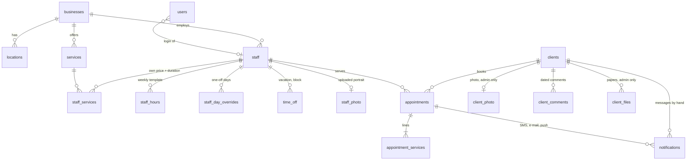

# Data model: draft 1

*17.11.2026. A draft for Dim to read, not built yet. It follows kickoff §6
(generic from the start) and copies patterns that already work in the shop
(`rempire-web/db/migrations`). Points that wait on an answer are marked
**[open]** with the question they wait on.*

## Rules for every table

- **Generic.** Business → Location → Staff. Every row carries `business_id`,
  so tattoo or another salon needs no reshaping later (Renat Q14, Q15).
- **Money** in integer cents (`*_cents int`), EUR. **VAT rates** in basis
  points (`2400` = 24 %), stored on every line, never looked up later.
- **Durations** in whole minutes.
- **Time.**
  - A moment is `timestamptz`.
  - A schedule is local wall-clock (`date` + `time`) read in the location's
    `timezone` (`Europe/Tallinn`).
  - Slot maths runs in local time and converts each slot with a tz library,
    never a fixed +02/+03, so both DST change days come out right.
- **IDs:** `uuid default gen_random_uuid()` (core on PG 13+, built into
  PGlite, as the shop's `001_core.sql` notes).
- **Texts clients see** (service names, role labels) are `jsonb`
  `{ru, et, en}`.
- **No hard deletes** of appointments or invoices. Status columns instead.
- **Every create is idempotent.** Copy the shop's `180_idempotency.sql`: the
  client mints a key per intention, so a double tap on «Book» books once.
- **Migrations:** numbered plain SQL, recorded by name, tests on PGlite, as
  in the shop. **[open]** Dim's answer on `db-layer`.
- **Seeds and tests use fake people only.**

## Map (Phase A)



## Phase A: booking core

### Who and where

| Table | Key columns | Notes |
|---|---|---|
| `businesses` | `slug`, `name`, `timezone`, `default_locale`, `settings jsonb` | `settings` holds the cancellation window, slot grid (15 min, as Altegio), the default reminder (120 min). |
| `locations` | `business_id`, `name`, `address`, `timezone`, `phone` | One today (Mardi 1). Altegio shows a location switcher, so keep it. |
| `staff` | `business_id`, `location_id`, `slug`, `display_name`, `role jsonb`, `photo_url`, `bio jsonb`, `bookable`, `sort`, `active` | `role` is the label: «Барбер» / «Tattoo artist». `slug` gives each rempire.ee card its own link with the barber pre-selected (kickoff §3, the free win). |
| `staff_photo` | PK `staff_id`; `mime`, `bytes bytea` (≤ 600 KB), `updated_at` | A portrait uploaded in the admin (Dim, 17.11.2026; migration 007). The browser shrinks it to a JPEG that fits 800×1000, about 100 KB. Kept in the database: a handful of barbers, no storage service, no keys. An upload sets `staff.photo_url` to `/api/staff-photo/<id>?v=<when>`; old links to files in `/public` keep working. Move to a bucket only if photos grow (galleries). |
| `client_push_subscriptions` | (`endpoint`, `appointment_id`) key, `business_id`, `p256dh`, `auth`, `label`, `retired_at` | One browser for one visit, for the reminder as a notification (012, 013, docs/apps.md). Turned on by the visit's own link; never tied to the client; no client account. |
| `users` | `email` unique, `password_hash`, `google_sub` unique, `role` (`owner`/`admin`/`staff`), `staff_id`, `locale`, `active`, `favourites text[]`, `client_columns text[]` | Logins for Renat and barbers. Clients are not users. `favourites` (017): the admin pages this login has starred, by the section's key, in the order added; the sidebar's «Избранное» (`src/lib/admin/favourites.ts`). `client_columns` (019): the columns this login keeps in the client table, of `phone`, `email`, `sold`, `visits`, `discount`, `last`, `first` (the name is always shown); null until the login chooses, which means all of them (`src/lib/admin/client-columns.ts`). The export to Excel has the same columns. Dim's choice: a password, or Google, with an e-mail code as the backup. `password_hash` is scrypt (built into Node, no native module). `google_sub` is Google's stable user id, never the e-mail. |
| `login_codes` | `email`, `code_hash`, `expires_at`, `attempts`, `used_at` | The 6-digit backup code by e-mail: a forgotten password, or Google not working. 10 minutes, 5 tries. |
| `sessions` | `token_hash`, `user_id`, `expires_at`, `device` | Long-lived for the barber PWA. |

**Google login, to test early:** an iPhone home-screen PWA opens Google's
sign-in page outside the app. Check on a real iPhone that the session
lands back in the installed app. If it doesn't, the barber app offers
password and code first there. Google needs an OAuth client in a Google
Cloud project. **[open]** Which Google account owns it, the shop's or
Dim's. Env var names: `GOOGLE_CLIENT_ID`, `GOOGLE_CLIENT_SECRET`.

### What and when

| Table | Key columns | Notes |
|---|---|---|
| `services` | `name jsonb`, `description jsonb`, `duration_min`, `price_cents`, `price_max_cents`, `buffer_after_min`, `online`, `sort`, `active` | `price_max_cents` covers «30–35 €» (grey coverage). «Father and son» is a service of its own, as in Altegio. |
| `staff_services` | PK (`staff_id`, `service_id`); `duration_min`, `price_cents`, `price_max_cents` (null = the service default), `active` | Prices and durations differ per barber (kickoff §3). **[open]** Renat Q8: who sets them. |
| `staff_hours` | `staff_id`, `weekday` 1–7, `starts time`, `ends time`, `valid_from`, `valid_to` | Several rows a day allowed. A break is the gap between two rows. |
| `staff_day_overrides` | `staff_id`, `date`, `intervals jsonb` (empty = day off) | A swapped shift or a short day without touching the template. |
| `time_off` | `staff_id`, `starts_at`, `ends_at`, `kind` (`vacation`/`sick`/`block`), `status` (`requested`/`approved`/`declined`), `note`, `created_by` | A barber blocking an hour is `kind = block`. **[open]** Renat Q9: whether barbers need approval. |
| `invoices.free` | `boolean`, default false | A free invoice (015; Dim, 19.11.2026: Renat's «new invoice → pick who gets it»). Beside the month's own invoice, which stays one per receiver and month; its period is the day it was made; it carries only typed lines, never the rent or a sale. |
| `special_time` | `staff_id`, `starts_at`, `ends_at`, `extra_cents`, `extra_pct`, `created_by` | Time a barber sets himself, any time of day, at a higher price (Renat via Dim, 17.11.2026). Each window has its own extra: an amount (`extra_cents`) **or** a whole percent of the visit's price (`extra_pct`, 0–300; Renat, 19.11.2026: «+50 %»), never both (014). The percent becomes money per visit, from that barber's prices for the visit's services (`extraFor` in `src/lib/slots.ts`). By adding it the barber commits to working it, so clients book it at once, no confirmation. Inside his hours it replaces the normal price for that time; outside his hours it adds bookable time. «Every Wednesday» in the app writes one row per week. The appointment keeps the extra in `appointments.extra_cents`. **[open]** Renat Q16: whether the extra goes to the barber whole. |

### Clients and appointments

| Table | Key columns | Notes |
|---|---|---|
| `clients` | `name`, `phone_e164`, `email`, `locale`, `sms_opt_out`, `email_opt_out`, `staff_note`, `labels text[]`, `source`, `altegio_id`, `merged_into` | Unique (`business_id`, `phone_e164`). `labels` are the client's categories (016; Dim, 19.11.2026): free words such as «VIP», «дети», set in the admin's «Клиенты» (`src/lib/admin/clients.ts`: trimmed, at most 30 characters, no word twice, at most 12 a client); the list to pick from is the words in use, there is no table of categories. Erasure on request, as the shop's `223_account_erasure.sql`. |
| `clients`, the full card (018; the owner, 19.11.2026) | `phone2_e164`, `birth_day`, `birth_month`, `birth_year`, `gender`, `importance`, `card_no`, `discount_pct`, `no_online`, `marketing_opt_out`, `push_opt_out`, `notify_off text[]` | Every earlier column stays. **The birthday is three numbers, not a date:** the year may be unknown («14.03»), so `birth_year` is null then; day and month come together (a check), and 29 February in a year that had none is refused by `src/lib/birthday.ts`. `gender` is `male`, `female` or null (not chosen); `importance` is `bronze`, `silver`, `gold` or null (no class). **`discount_pct` (0–100) is stored and shown only:** no booking, sale or invoice reads it. `no_online`: an online booking with either of his phones is refused as any refused request is, with no reason given (`src/lib/booking.ts`); the staff still book him. `phone2_e164` is not a key: two clients may share one. `marketing_opt_out` («Рекламные сообщения: не отправлять»): a mass message from the client base is advertising and goes to nobody who has it (019, below). `sms_opt_out`, `email_opt_out` and `push_opt_out` are the channels he accepts; `notify_off` lists the kinds he has switched off, of the four we send a client by ourselves: `confirmation`, `reminder` (the SMS and the notification), `moved`, `cancelled` (`src/lib/client-notify.ts`). Whoever queues a message asks first, so a kind or a channel that is off is never queued for him, and a queued reminder is cancelled at the next cron run. A client is deleted only when nothing names him: no visit (cancelled ones count: visits are never deleted), no product sale, no client merged into him. |
| `clients`, the client base (019; the owner, 19.11.2026) | `mass_sent_at` | When a mass message was last queued for him; null: never. Set together with the outbox rows (`src/lib/admin/client-bulk.ts`), so the list's condition «получал рассылку» still holds after the outbox is cleaned. Nothing else is new for the list in full: its conditions (visits, their status, number and dates, the barber, the services, sums, gender, category, importance class, birthday, age, «no online booking») are read from the columns above and from `appointments`, each as one small unit with placeholders (`src/lib/admin/client-filter.ts`), joined by «И» or «Или»; a segment is three of those conditions filled in for today (new: a visit in the last 30 days and none before them; returning: one in the last 30 days and one before them; lost: has visits, none in the last 60 days and none ahead). |
| `client_photo` (018) | `client_id` (key), `mime`, `bytes`, `updated_at` | His photo, kept as `staff_photo` keeps a barber's: in the database, shrunk by the browser first, 600 KB at most. Never public: only `/admin/clients/<id>/photo` serves it, to a login of the business. |
| `client_comments` (018) | `client_id`, `author_id`, `author_name`, `body`, `created_at` | The dated history beside the one shared note (`clients.staff_note`, «Примечание»). `author_name` is copied, so a comment still says who wrote it after the login is gone. Anyone in the admin adds one; Renat and the front desk delete anyone's (finer rights come later). 2000 characters at most. |
| `client_files` (018) | `client_id`, `name`, `mime`, `size`, `bytes`, `uploaded_by`, `uploaded_name`, `created_at` | A client's papers, in the database: 5 MB each, 20 a client. Nine kinds (jpeg, png, gif, pdf, doc, docx, xls, xlsx, txt), told three ways that must agree: the name's ending, the type the browser declared and, for the kinds that have a signature, the first bytes (`src/lib/admin/client-card.ts`). `mime` is ours, by the name's ending. Never public: only `/admin/clients/<id>/files/<file id>` serves one, to a login of the business, always as a download (`Content-Disposition: attachment`, `X-Content-Type-Options: nosniff`). Uploaded by `POST /admin/clients/<id>/files`, one file a request, from our own pages only. |
| `appointments` | `location_id`, `staff_id`, `client_id`, `starts_at`, `ends_at`, `status`, `source`, `any_staff`, `client_comment`, `staff_note`, `reminder_min`, `total_cents`, `locale`, `manage_token_hash`, `cancelled_at`, `cancelled_by`, `altegio_id` | See the status list below. `any_staff` records that the client picked «anyone». `reminder_min` null = no reminder, the client's choice as in Altegio. |
| `appointment_services` | (`appointment_id`, `position`); `service_id`, `duration_min`, `price_cents` | Several services in one visit. Duration and price are copied at booking, so a later price change never rewrites history. |
| `notifications` | `appointment_id`, `channel` (`sms`/`email`/`push`), `kind`, `send_at`, `status`, `provider`, `provider_ref`, `segments`, `cost_cents`, `attempts`, `last_error` | An outbox. A cron picks due rows with `for update skip locked`. Moving a visit cancels its queued rows and adds new ones. `cost_cents` lets Renat see the SMS bill. `client_id` (018) is set on a message written by hand on a client's card (`kind` «manual», its words in `payload.text`): it belongs to no visit, so it names its client; rows about a visit find their client through the visit. A «manual» row goes like any other: an SMS waits while there is no provider, a letter passes the staging mail guard, a notification goes to the phones turned on for the client's next visit (`appointment_id`). **A mass message** from the client base (019) is one row per client and channel of `kind` «mass», the same words in every `payload.text`, the client in `client_id`, and `payload.batch` the same for the whole sending; it goes out exactly as a «manual» row does. It is queued only for a client who has not ticked «Рекламные сообщения: не отправлять», and by a channel only if he accepts it and has an address for it (a phone, an e-mail, a phone turned on for a visit ahead). |
| `audit` | `at`, `user_id`, `entity`, `entity_id`, `action`, `before`, `after`, `device` | Who moved or cancelled what. The shop has the same idea (`207_audit_prev.sql`). The client base (019) writes four actions on `entity` «client», none with a client's name, phone or words in it: `export` (one row per file: who, when, `rows` and `columns`, never the rows themselves), `mass_message` (one row per sending: `batch`, `channels`, how many clients were chosen and reached, the rows by channel and the SMS `parts`), `bulk_label` (the category, how many clients, to how many it was added) and, for each client deleted with many, the `delete` row a single delete writes, marked `bulk`. |
| `idempotency_keys` | copied from the shop | |

**Appointment status:** `pending` → `booked` → `arrived` → `done`, or
`cancelled`, or `no_show`. `pending` is only used if barbers must accept a
booking first. **[open]** Renat Q10.

### No double booking, enforced by the database

```sql
create extension if not exists btree_gist;

alter table appointments add constraint appointments_no_overlap
  exclude using gist (staff_id with =, tstzrange(starts_at, ends_at) with &&)
  where (status not in ('cancelled'));
```

- The constraint covers appointment against appointment.
- Time off lives in another table, so one constraint can't cover it.
  - Every booking and every time-off write first takes the staff row:
    `select 1 from staff where id = $1 for update`.
  - That queues writes per barber. The slot check and the insert run inside
    that lock.
- **To check in the first test:** PGlite ships `btree_gist` as a contrib
  extension. The shop's tests run on PGlite, so ours must load it.

### How a slot is found

1. Take the barber's intervals for that local date: the template, or that
   day's override.
2. Remove approved time off, then existing appointments plus their buffers.
3. Walk the free intervals on the 15-minute grid. A slot fits if the sum of
   the chosen services' durations for **that barber** fits.
4. Convert each local slot to `timestamptz` with the location's time zone.
5. «Anyone» means the union of all bookable barbers. The tie goes to the
   barber with fewer bookings that day.
6. «Nearest free» searches forward day by day, up to 60 days. Altegio shows
   this as «Next available date».

## Phase B: barber PWA

| Table | Key columns | Notes |
|---|---|---|
| `push_subscriptions` | `user_id`, `endpoint` unique, `keys jsonb`, `last_ok_at` | Copy the shop's `200_push_subscriptions.sql`, with new VAPID keys. |

Everything else in Phase B reads and writes the Phase A tables.

## Phase C: sales and invoices (outline)

Built as `db/migrations/010_sales_invoices.sql` (17.11.2026). The columns
there are the truth; the outline below was the plan. The main additions:
`product_sales` keeps the shop's purchase and list price, its sync state
and `reverses_id` (a minus row); `invoices` has `kind`
(`invoice`/`credit`) and the two parties frozen at «Выставить» (`seller`, `buyer`); `invoice_lines` has
`rent_month`; and the 17 %, its basis and the billing day live in
`businesses.settings`.

| Table | Key columns | Notes |
|---|---|---|
| `product_sales` | `ref` unique, `staff_id`, `mode` (`client`/`self`), `shop_product_id text`, `shop_variant text`, `name`, `qty`, `unit_cents`, `vat_bp`, `commission_bp` (1700), `commission_cents`, `shop_order_ref`, `sync_status`, `invoice_id`, `client_id` | `shop_product_id` + `shop_variant` match the shop's `stock_levels` key (`090_inventory.sql`). `client_id` (017): the client who bought, when the admin's «Продажа товара» names one; null for a sale from the barber app. `ref` is the idempotency key sent to the shop's partner endpoint. **[open]** Renat Q2: the 17 % basis. |
| `invoice_issuers` | `legal_name`, `reg_code`, `vat_number`, `address`, `iban`, `email`, `prefix` | REMPIRE's company, or companies. **[open]** Renat Q1. |
| `invoice_receivers` | `kind` (`person`/`fie`/`ou`), `legal_name`, `reg_code`, `vat_number`, `address`, `email`, `staff_id`, `vat_mode`, `terms_days`, `active` | The CRUD from decision 7. |
| `chair_rents` | `staff_id`, `receiver_id`, `amount_cents`, `period` (`month`/`week`), `valid_from`, `valid_to` | **[open]** Renat Q3. |
| `invoices` | `issuer_id`, `receiver_id`, `number` unique per issuer, `issued_on`, `due_on`, `period_from`, `period_to`, `status`, `net_cents`, `vat_cents`, `gross_cents`, `pdf_key`, `sent_at`, `paid_at`, `credit_of` | Never edited once issued; a correction is a credit invoice. |
| `invoice_lines` | `invoice_id`, `position`, `kind` (`rent`/`product`/`commission`/`other`), `text`, `qty`, `unit_cents`, `vat_bp`, `net_cents`, `vat_cents`, `sale_id` | |
| `invoice_counters` | PK (`issuer_id`, `year`), `last` | The shop's `141_invoices.sql` pattern. One `insert … on conflict do update … returning` hands out the next number with no gaps or twins. |

### Two invoice points to clear before building

- **VAT.** On a domestic invoice, VAT usually follows the **issuer's**
  registration, not the receiver's.
  - Decision 13 says it depends on the receiver. That fits if REMPIRE has two
    companies, one VAT-registered and one not.
  - The model keeps both: `vat_number` on the issuer, `vat_mode` on the
    receiver.
  - Renat Q1 and his accountant settle it.
- **Netting the 17 %.** The commission is money REMPIRE owes the barber.
  - Putting it on REMPIRE's invoice as a minus line nets the two.
  - If a barber's company is VAT-registered, the commission is their sale to
    REMPIRE, with their VAT. That may need its own document, such as
    self-billing.
  - Ask the accountant before building the netting. Renat Q4 shows how
    Isolta does it today.

## Altegio import

| Altegio | Goes to |
|---|---|
| Staff | `staff` + `staff_hours` |
| Services and each barber's price and duration | `services` + `staff_services` |
| Clients | `clients` (`source = altegio`, `altegio_id`) |
| Future appointments | `appointments` (`source = import`) |
| Reviews | a `reviews` table, only if Renat wants them moved (Q12) |

The import runs from Altegio's export files once Dim has the login (§11.4).
Real client data goes straight to the database, never into the repo.

**What Altegio's admin gives (looked at 19.11.2026, nothing pressed):**

- **«Операции с Excel» → «Выгрузить в Excel»** on three pages: «Клиентская
  база», «Записи» and «Категории услуг».
  - The client list shows: name, phone, e-mail, sold, account balance,
    visits, discount, last visit, first visit. A client's card also has: a
    second phone, category, gender, importance class, card number, birthday,
    note, «no online booking».
  - «Записи» shows: staff, service, client, visit time, created by, visit
    status, source; it filters by visit date and by created date.
- **«График работы»** only prints to PDF. Six staff, so the hours are typed
  in by hand.
- **Services:** one category with 12 services; three have no staff and are
  not offered. Where the duration reads «Индивидуально», each barber has his
  own.
- **The file's own columns are not known yet:** that needs one export of
  each, which is a download of real client data, so it waits for Dim's OK.
- **The way in:** an owner-only «Импорт» page in the admin takes the three
  files as they are; the same page runs again on the cut-over day.
